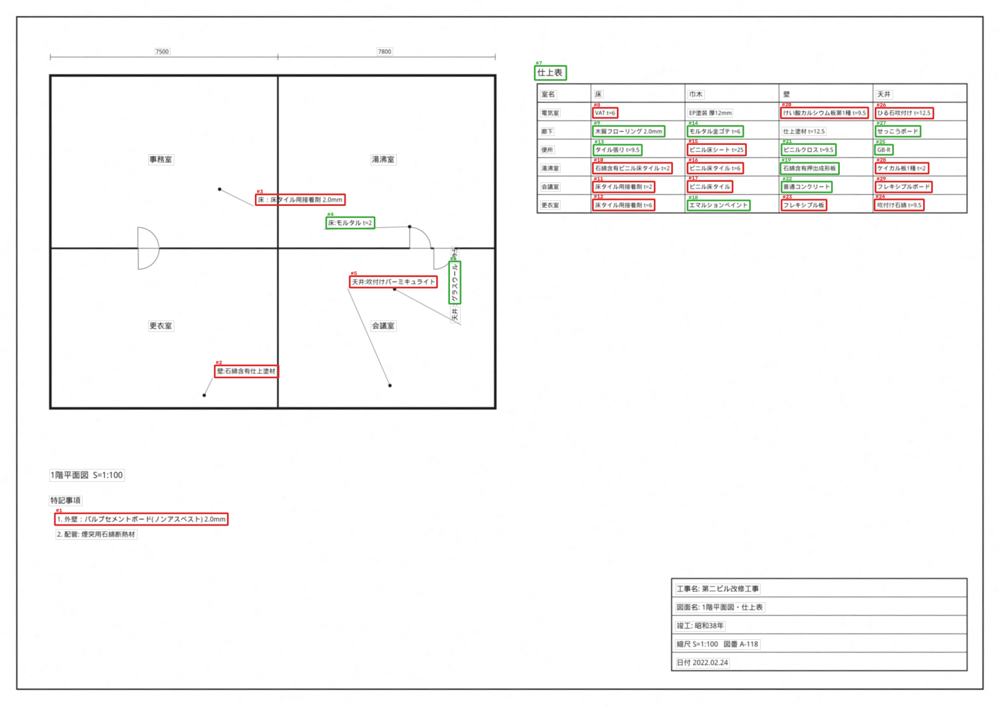

# Asbestos Material Detection from Building Drawings

An OCR + layout-analysis + fuzzy-matching pipeline that reads architectural drawings (vector or scanned,
English and Japanese), extracts every material annotation and finish-schedule entry, and classifies each
one as **asbestos-containing**, **not containing** or **needs review** by cross-matching it against an
asbestos building-materials database and the building's construction year.


<sub>Degraded scan from the held-out test split after deskew + OCR. Red = asbestos-containing, orange = needs review, green = not containing, grey = other text.</sub>

## Results

30 synthetic A3 drawings (≈790 text lines, ≈816 material entries in total). The match threshold was chosen on the
dev split (drawings 0–14) and **all numbers below are on the held-out test split (drawings 15–29, 404 materials)**.
Full output: [results/metrics_pre.json](results/metrics_pre.json).

| | Vector PDF | Degraded scan (OCR) |
|---|---|---|
| Text detection P / R / F1 (IoU ≥ 0.5) | 1.00 / 1.00 / 1.00 | 0.967 / 0.972 / **0.969** |
| CER: all / Japanese / English lines | 0 / 0 / 0 | **15.0 %** / 16.7 % / 9.3 % |
| Deskew error (mean, applied skew ±2°) | – | **0.010°** |
| Construction-year extraction | 100 % | 100 % (dev: 93 %) |
| Material identified correctly | 100 % | **92.6 %** |
| 3-class label accuracy | 100 % | 92.3 % |
| **Asbestos flag P / R / F1** (asbestos or needs review) | 1.00 / 1.00 / 1.00 | **0.962 / 0.951 / 0.956** |
| Time per page (CPU) | 0.1 s | ≈ 95 s |

**Matching-engine ablation**: material-ID accuracy on the test split, using the text the OCR actually produced:

| Method | Clean text | OCR text | False matches on non-material text |
|---|---|---|---|
| Exact / substring dictionary lookup | 98.3 % | 69.3 % | 0 % |
| RapidFuzz (edit distance) | 100 % | 90.1 % | 5.6 % |
| Character n-gram TF-IDF | 100 % | 89.9 % | 0 % |
| **Hybrid (fuzzy + TF-IDF, RRF)** | **100 %** | **92.6 %** | 4.2 % |

Exact lookup is fine on clean text but loses almost a third of materials once OCR introduces errors. The hybrid
recovers most of them because the two signals fail differently: edit distance handles a wrong character inside a
short word, while TF-IDF n-grams handle long names with several scattered errors.

**Threshold (dev split, scans):** a lower threshold trades precision for recall. Missing asbestos costs far more
than an extra review, so the threshold is chosen by F1 with ties broken toward recall.

| threshold | 0.60 | 0.70 | 0.75 | 0.80 | 0.90 |
|---|---|---|---|---|---|
| precision | 0.949 | 0.981 | 1.00 | 1.00 | 1.00 |
| recall | **0.888** | 0.845 | 0.813 | 0.797 | 0.695 |

**What the error analysis changed** (each fix was found on the dev split):
- Japanese OCR reads 竣 as 峻/瑛, so the year keyword was missed: year accuracy rose from 60 % → 93 % (dev), and asbestos-flag F1 on the test split rose from 0.928 → 0.956.
- 含 is read as 合 in 石綿含有 ("asbestos-containing"), which is fixed with an explicit confusion table. A fuzzy marker
  check was tried first and rejected: it read *"asbestos-containing"* as *"non-asbestos"*, the most dangerous error
  this system can make. There is a regression test for it.
- Table headers ("Floor", "天井") partially matched "vinyl **floor** tile", so partial matching is now only allowed when the
  query covers most of the database name.
- Hough-only deskew failed on noisy 220-dpi scans (3.8° error). A projection-profile search was added, and the worst-case error is now 0.1°.

**Remaining errors (scans):** nearly all trace back to OCR: small spec text (`t=12.5` → `[=12.5`), dropped
digits in era years (昭和40年 → 昭和4年), and truncated vertical annotations. Most false positives are text like the
table title 仕上表 partially matching 塗装仕上げ (paint finish), or a garbled "(ノンアスベスト)" that leaves a non-asbestos item flagged. Both
err toward caution.

## How it works

```
PDF / scan / photo
  │
  ├─ 1. Ingest ─────────── vector PDF? → take embedded text + exact boxes (PyMuPDF), no OCR needed
  │                         scanned?   → rasterize and continue
  ├─ 2. Preprocess ──────── deskew (Hough lines + projection-profile refinement), non-local-means denoise,
  │                         tiling for sheets larger than 3600 px
  ├─ 3. Layout ──────────── finish-schedule (仕上表) table detection from morphological ruling lines →
  │                         cell grid; text fragments are never merged across cell borders
  ├─ 4. OCR ─────────────── CRAFT text detection + CRNN/CTC recognition (EasyOCR, ja+en); tall boxes are
  │                         vertical annotations → crop is rotated both ways, best read kept
  ├─ 5. Parse ───────────── NFKC, kana unification, OCR-confusion fixes (合有→含有), strip location prefix
  │                         (天井: / Wall:), specs (t=12.5, 厚9.5mm), note numbering, asbestos markers
  ├─ 6. Match ───────────── RapidFuzz similarity + character n-gram TF-IDF, fused with Reciprocal Rank Fusion
  │                         against names, Japanese names and trade aliases (PB, ケイカル板, Pタイル, ECP …)
  ├─ 7. Decide ──────────── explicit marking (石綿含有 / ノンアスベスト) > product type > construction year vs.
  │                         asbestos-production period (incl. Japan's 2006 total ban); year read from the
  │                         title block, including Japanese era years (昭和53年 → 1978)
  └─ 8. Output ──────────── annotated drawing, CSV/JSON report with the reason for every decision
```

**Why "needs review" exists:** a drawing that says *せっこうボード* (gypsum board) cannot be classified from
text alone. Only some gypsum boards made between 1970 and 1986 contained asbestos. With a construction year the
system decides (presumed asbestos-containing inside that window, as Japanese practice "みなし" allows); without one it
flags the item for a surveyor instead of guessing. Asbestos recall is the metric that matters, so uncertainty
is always resolved toward review.

## Quick start

```bash
pip install -r requirements.txt

# analyze a drawing (PDF or image) -> CSV/JSON report + annotated PNG
python scripts/analyze.py data/samples/drawing_000_scan.png --out out/
python scripts/analyze.py my_drawing.pdf --year 1978

# web demo / REST API
streamlit run app/streamlit_app.py
uvicorn app.api:app          # POST /analyze  (multipart: file, build_year?, force_ocr?)

# reproduce the evaluation
python scripts/generate_synthetic.py --n 30 --out data/synthetic
python scripts/evaluate.py --modes vector scan
pytest
```

Docker: `docker build -t asbestos-detector . && docker run -p 8000:8000 asbestos-detector`

## Data

**Materials database** ([data/asbestos_materials.csv](data/asbestos_materials.csv)): 22 asbestos-bearing
product types (sprayed asbestos, sprayed rock wool, calcium silicate boards, flexible boards, slates,
rock-wool ceiling boards, gypsum board, vinyl floor tiles, finish coatings, …) and 12 non-asbestos materials,
each with Japanese and English names, trade aliases and approximate asbestos-production periods. These are
generic categories that follow the structure of Japanese public guidance (MLIT/MHLW asbestos building-materials
references). **The years are approximate seed values; for real use, replace this file with
MLIT's 石綿含有建材データベース (product-level, by manufacturer).**

**Synthetic drawings** ([scripts/generate_synthetic.py](scripts/generate_synthetic.py)): real annotated
asbestos drawings are not publicly available, so the generator builds A3 sheets with a floor plan, leader-line
annotations (25 % rotated 90°), a finish schedule table, specification notes and a title block whose year is
written as 昭和/平成 era, Western year, or not at all. Each sheet is saved as a **vector PDF** and as a
**degraded scan** (±2° skew, 180–220 dpi, faded toner, Gaussian noise, speckles, blur, JPEG q50–85) with exact
ground-truth boxes, text, material IDs and expected labels. Three samples are in [data/samples](data/samples).

## Project layout

```
src/asbestos_detector/
  ingest.py      PDF/image loading, vector text extraction
  preprocess.py  deskew, denoise, binarize, tiling
  layout.py      finish-schedule table / cell detection
  ocr.py         EasyOCR backend (+ optional PaddleOCR)
  geometry.py    text lines, IoU, cell-aware line merging
  normalize.py   NFKC/kana normalization, annotation parsing, era-year parsing
  matcher.py     exact / fuzzy / TF-IDF / hybrid-RRF matching
  rules.py       asbestos decision rules
  pipeline.py    end-to-end Analyzer + report
  metrics.py     CER, WER, IoU matching, P/R/F1
scripts/         generate_synthetic.py, evaluate.py, analyze.py
app/             FastAPI service, Streamlit demo
tests/           unit tests (pytest)
```

## Limitations and next steps

- Evaluated on synthetic drawings only. The next step is ~100 real drawings annotated in Label Studio/CVAT.
- OCR is an off-the-shelf model. Fine-tuning recognition (PaddleOCR SVTR or TrOCR) on synthetic
  drawing-text crops is the clearest way to lower CER on small Japanese text and spec values.
- Vertical Japanese writing (縦書き) and text curved along leader lines are not handled.
- Construction year ≠ installation year: renovations can introduce newer or older materials.
- Screening aid only. Japanese law requires a qualified survey (事前調査) and lab analysis to confirm asbestos.
